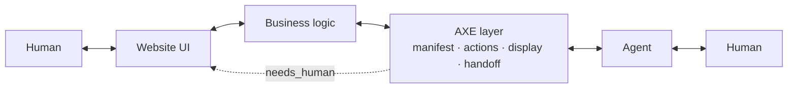

# AXE documentation

AXE (Agentic eXperience Engineering) lets a website expose a small, typed, agent-specific interface next to the one humans use. These pages take you from "why" to a working, conformant endpoint, then go deep.

## The pitch, in 200 words

Agents are becoming a front door to your business. Today they reach you through a headless browser, and it fails in predictable ways: multi-step forms with client-side state, ambiguous buttons, CAPTCHAs, and moments where a human genuinely has to do something (pay, consent, prove identity) with no structured way to hand off and come back. The agent gives up and tells the user to do it themselves.

AXE is the layer that fixes this without a rewrite. You declare what your site can do as typed actions, wrapping functions you already have. You declare how results should be presented so any agent can show a user a comparable set of options. When an action cannot finish, you say exactly what would unblock it, in a form the agent may already hold: a payment credential, an address, a consent. Only when nothing the agent has will do, you hand off to the human with a URL, a plain-language reason, and a token to resume.

The declaration is served as JSON over HTTPS, consumable with `fetch`, and derives an MCP server for free. Discovery, descriptions written for models, risk metadata, idempotency, and a conformance suite come with it. Think sitemap, meta tags, and Webmaster Tools, for agents.

## The 30-second mental model

The business logic is yours and does not change. The AXE layer is a manifest plus a set of actions that call into it. Agents talk to the AXE layer; humans keep talking to the UI; when an action needs the human, the AXE layer sends them to the UI and lets the agent resume afterward.

## Pages

Start at the top and read down. Each page ends with next steps.

1. [Why AXE](why-axe.md) — the problem, the SEO analogy mapped once, why headless browsing does not scale, why this is not "just an API", and when not to use it yet.
2. [Getting started](getting-started.md) — a 15-minute tutorial: install, one read-only action, mount, `axe inspect`, `axe conformance`, connect Claude Desktop.
3. [Concepts](concepts.md) — manifest, actions, display and affordances, the result envelope, the escalation ladder, requirements and kinds, handoff and resume, idempotency, auth, flows, risk.
4. [Designing actions](designing-actions.md) — the most important guide: decomposing a human flow, writing descriptions for a model, choosing risk, designing requirements, designing read actions, anti-patterns, a worked example.
5. [Presenting results](presenting-results.md) — the search → present → select arc: `display`, pointers, attributes, disclaimer and url, brand, affordances, pagination and freshness, the reference renderers.
6. [Requirements and kinds](requirements-and-kinds.md) — the `needs_input` contract, the well-known kind registry, custom kinds, validation, chaining, security of sensitive payloads.
7. [Human handoff](human-handoff.md) — when it is necessary, the lifecycle, the resume landing page, token security, what to show the human.
8. [Auth](auth.md) — the three modes, passing your session in, API keys, the v1 OAuth path.
9. Integrations: [Express](integrations/express.md), [Next.js](integrations/next.md), [fetch-based frameworks](integrations/fetch.md) (Hono, Remix, Workers, Bun, SvelteKit).
10. [MCP](mcp.md) — the derived MCP server, the mapping table, connecting clients, limits.
11. [For agent builders](for-agent-builders.md) — `@axe/client`, wrapping it as a tool, handling each status, fulfillers, confirming sensitive payloads, phrasing handoffs.
12. [Testing and conformance](testing-and-conformance.md) — unit testing actions, running conformance locally and in CI, reading the report.
13. [Security](security.md) — threat model, what the SDK mitigates, what your site must.
14. [Audit](audit.md) — the AXE Score: categories, weights, every check, the honesty rules.
15. [Analytics](analytics.md) — the event schema, sinks, and the day-one queries.
16. [Platforms](platforms.md) — multi-tenant hosts: define once, serve per tenant, publish an index.
17. [Deploying](deploying.md) — CORS, caching, rate limiting, observability, rolling out one action at a time.
18. [API reference](api/README.md) — generated from the source for every package.
19. [FAQ](faq.md) — MCP, OpenAPI, llms.txt, schema.org, Agent Protocol, A2A; will agents use it; what stops a site from lying.
20. [Glossary](glossary.md).
21. [The website](site.md) — how the static site in `site/` is built from these pages, and how to run its tests.

Normative documents live in [`spec/`](../spec/AXE-PROTOCOL.md): the protocol, the [kind registry](../spec/KINDS.md), the [event schema](../spec/EVENTS.md), and the [vocabulary](../spec/VOCABULARY.md) that every name in these pages is checked against.

## How these docs are written

- Short paragraphs. Code before prose where a reader can learn from the code.
- Every TypeScript block is pulled from [`docs/examples/`](examples/) and typechecked; if it is in the docs, it compiles.
- Every wire name, CLI command, and API identifier is spelled the way [`spec/VOCABULARY.md`](../spec/VOCABULARY.md) spells it. A test fails otherwise.
- Four rotating example organizations, so no reader thinks this is for one industry: a yoga studio, a university admissions office, an apartment property manager, and an online shop.
- American English, second person, no marketing adjectives. Admonitions (`> **Note**`, `> **Warning**`) only when the reader would otherwise get hurt.

## Next steps

- New here: [Why AXE](why-axe.md), then [Getting started](getting-started.md).
- Integrating: [Designing actions](designing-actions.md).
- Building an agent: [For agent builders](for-agent-builders.md).
