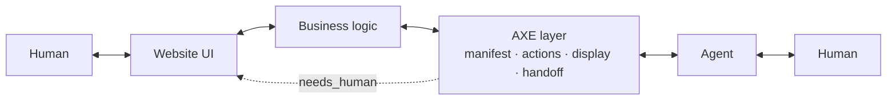

# AXE documentation

The Body Spray SDK exposes an application's existing capabilities to people and to agents through the same logic. These pages take you from "why" to a working integration, then go deep.

## The pitch, in 200 words

People and agents increasingly work in the same applications: planning tools, admin consoles, internal workflows. An agent driving the human UI breaks when a label changes, cannot tell why a control is disabled, and has no safe way to stop for a person's approval. A typed API beside the UI drifts from it and knows nothing of the other participant.

The SDK keeps one set of application logic for both. You declare typed actions with explicit permissions, or register the controls the page already has. Every action reports whether it can run now and why not. Results use one envelope with five statuses, so "needs input" and "needs a person" are answers, not errors. Writes carry the state the agent saw and are refused if it changed. Consequential calls wait for an approval bound to the exact call, and retries replay a finished operation instead of repeating it.

Agents reach this through interfaces they already use: an MCP server, WebMCP tools in the browser, or the page's own accessible names. AXE is the HTTP representation underneath. It is useful, but publishing it does not make agents find a site. What the SDK does and does not prove is set out in [Testing and conformance](testing-and-conformance.md) and [Evaluation](evaluation.md).

## The 30-second mental model

The business logic is yours and does not change. The AXE layer is a manifest plus a set of actions that call into it. Agents talk to the AXE layer; humans keep talking to the UI; when an action needs the human, the AXE layer sends them to the UI and lets the agent resume afterward.

**The default way an agent uses your application:** [Unattended mode](host.md). The person signs in once, in the agent's own UI; the SDK runs your application in a headless browser for them, and the agent acts through the application's real UI. No pairing, no tab of their own. Locally: `axe host login`, then `axe host --dev`.

## Pages

Start at the top and read down. Each page ends with next steps.

1. [Why AXE](why-axe.md) — the problem, the SEO analogy mapped once, why headless browsing does not scale, why this is not "just an API", and when not to use it yet.
2. [Getting started](getting-started.md) — a 15-minute tutorial: install, one read-only action, mount, `axe inspect`, `axe conformance`, connect Claude Desktop.
3. [Concepts](concepts.md) — manifest, actions, display and affordances, the result envelope, the escalation ladder, requirements and kinds, handoff and resume, idempotency, auth, flows, risk.
4. [Surface](surface.md) — live state for agents: an application's registry of its own controls, with reasons and one revision, served as AXE actions.
5. [Easy mode: derive, then refine](auto-surface.md) — `@axe/surface/auto`: a surface read from the rendered page, the three guarantee tiers, safety defaults and approval, the configuration overlay, coverage, and generic tools.
6. [Designing actions](designing-actions.md) — the most important guide: decomposing a human flow, writing descriptions for a model, choosing risk, designing requirements, designing read actions, anti-patterns, a worked example.
7. [Schemas: the supported subset](schemas.md) — the JSON Schema keywords the validator, the Zod converter, and `@axe/generate` support, how unsupported constructs fail, patterns and backtracking, refinements, and input as sent versus input as parsed.
8. [Generating actions](generating.md) — derive actions from what you already have: an OpenAPI document, a zod-typed function table, a tRPC router; overrides, policy, what the generator refuses to invent, `axe generate`.
9. [Presenting results](presenting-results.md) — the search → present → select arc: `display`, pointers, attributes, disclaimer and url, brand, affordances, pagination and freshness, the reference renderers.
10. [Requirements and kinds](requirements-and-kinds.md) — the `needs_input` contract, the well-known kind registry, custom kinds, validation, chaining, security of sensitive payloads.
11. [Human handoff](human-handoff.md) — when it is necessary, the lifecycle, the resume landing page, token security, what to show the human.
12. [Human oversight](human-oversight.md) — approval requests: a person approves a consequential call on the site, bound to the call, the principal, the tenant, and the state; cancellation, invalidation, expiry, replay, receipts, and one history.
13. [Live state and revisions](live-state.md) — what can be done right now and why not the rest, the state the agent saw, `expectedRev` and `rev`, `/axe/state`, how it composes with idempotency and Surface.
14. [Reference application](reference-app.md) — Plan Review, a runnable Next.js app: server actions over AXE and browser-local controls on the page, two people and two tenants, conflicts, approvals, and browser tests; who owns each capability and what the app deliberately does not do.
15. [Evaluation](evaluation.md) — the reference app under four agent interfaces (generic markup, accessible names, basic tools, AXE) with scripted agents and outcome checks: what is measured, how to run it, the recorded results, and what has not been run.
16. [Pilot plan](pilot-plan.md) — a plan, not yet run, for testing with three to five external design partners: selection, tasks, baselines, instrumentation, and proposed go/no-go thresholds.
17. [Auth](auth.md) — the three modes, passing your session in, API keys, the v1 OAuth path.
18. Integrations: [Express](integrations/express.md), [Next.js](integrations/next.md), [fetch-based frameworks](integrations/fetch.md) (Hono, Remix, Workers, Bun, SvelteKit).
19. [MCP](mcp.md) — the derived MCP server, the mapping table, elicitation and the Apps view, connecting clients, limits.
20. [Relay](relay.md) — an agent outside the browser (Claude Code over MCP) driving a signed-in person's live tab: the page connects its surface, the relay serves it; development pairing in one command, production with relay tokens and OAuth, Stop, approvals, and the security model.
21. [Unattended mode](host.md) — the default: the agent signs in, the SDK runs the application in a headless browser for that person (`@axe/host`), and the agent drives the real UI with no pairing; development in two commands (`axe host login`, `axe host --dev`), production with OAuth and the application's `sessionFor`, the security model, and limits.
22. [WebMCP](webmcp.md) — a Surface offered to the browser's own agent: status of the draft API, feature detection, what is exposed and what never is, the fallback.
23. [For agent builders](for-agent-builders.md) — `@axe/client`, wrapping it as a tool, handling each status, fulfillers, confirming sensitive payloads, phrasing handoffs.
24. [Testing and conformance](testing-and-conformance.md) — unit testing actions, running conformance locally and in CI, reading the report.
25. [Security](security.md) — threat model, what the SDK mitigates, what your site must.
26. [Audit](audit.md) — the AXE Score: categories, weights, every check, the honesty rules.
27. [Analytics](analytics.md) — the event schema, sinks, and the day-one queries.
28. [Platforms](platforms.md) — multi-tenant hosts: define once, serve per tenant, publish an index.
29. [Deploying](deploying.md) — CORS, caching, rate limiting, observability, rolling out one action at a time.
30. [API reference](api/README.md) — generated from the source for every package.
31. [FAQ](faq.md) — MCP, OpenAPI, llms.txt, schema.org, Agent Protocol, A2A; will agents use it; what stops a site from lying.
32. [Glossary](glossary.md).
33. [The website](site.md) — how the static site in `site/` is built from these pages, and how to run its tests.

Normative documents live in [`spec/`](../spec/AXE-PROTOCOL.md): the protocol, the [kind registry](../spec/KINDS.md), the [event schema](../spec/EVENTS.md), and the [vocabulary](../spec/VOCABULARY.md) that every name in these pages is checked against.

For agents implementing this: [llms.txt](../llms.txt) at the repository root is the integration guide, and the site publishes it with a full-text companion.

## How these docs are written

- Short paragraphs. Code before prose where a reader can learn from the code.
- Every TypeScript block is pulled from [`docs/examples/`](examples/) and typechecked; if it is in the docs, it compiles.
- Every wire name, CLI command, and API identifier is spelled the way [`spec/VOCABULARY.md`](../spec/VOCABULARY.md) spells it. A test fails otherwise.
- Four rotating example organizations, so no reader thinks this is for one industry: a yoga studio, a university admissions office, an apartment property manager, and an online shop.
- American English, second person, no marketing adjectives. Admonitions (`> **Note**`, `> **Warning**`) only when the reader would otherwise get hurt.

## Next steps

- New here: [Why AXE](why-axe.md), then [Getting started](getting-started.md).
- Integrating: [Designing actions](designing-actions.md).
- Building an agent: [For agent builders](for-agent-builders.md).
