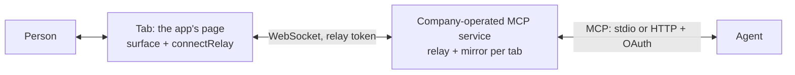

# Relay: an agent in a live tab

A surface lives in the browser tab that created it ([Surface](surface.md), "Where a surface runs"). An agent outside the browser, such as Claude Code, cannot reach it: the controls are closures over that page's state, acting with that page's session. `@axe/relay` is the SDK's broker for exactly this: the page connects to a relay server, the relay presents the page's surface to agents over MCP, and every act runs in the page, through the page's own `surface.act`.



Desktop agents need the service path on this page. The customer application installs only `@axe/surface` and the browser-only `@axe/relay/client`; the separately operated service owns the MCP SDK, WebSocket server, agent authentication, and relay records. Browser-native WebMCP remains an additional direct path where the browser supports it.

There are three connection shapes. **Browser handoff** is the recommended provider path: the agent's OAuth identity mints a one-time URL, the client opens the application's ordinary sign-in/page flow, and the installed package connects that attended tab automatically with no pairing code or application backend endpoint. **Development pairing** is the local diagnostic path: the person opens the tab and copies its temporary code. **Unattended host** ([Unattended mode](host.md)) is optional: a host runs a hidden browser session and therefore requires the application to provide a browser-session boundary.

The relay reuses the rest of the SDK: each tab is served through `domainActions` from `@axe/surface/axe` on a `createAXE` server, and `@axe/mcp` derives the tools. The revision check, the escalation ladder, the ledger, and the action events are the ones you already have. The normative rules are [S-RELAY-1] to [S-RELAY-14] in [spec/SURFACE.md](../spec/SURFACE.md) §9.1.

## Self-hosted attended mode in four steps

For an application operating its own relay and identity boundary. The provider-operated browser-handoff path below removes steps 2 and 3 from the consuming application's installation.

1. Add the packages: `pnpm add @axe/surface @axe/relay`.
2. In the page, register the controls on a surface (or let `@axe/surface/auto` do it) and connect it:

<!-- include: examples/relay/page.ts#connect -->
```ts
// Your backend mints a short-lived relay token for the signed-in person (see the next example);
// the page asks for one on every connection and before the current one expires.
const relay = connectRelay(surface, {
  url: "wss://relay.yogastudio.example/tab",
  getToken: async () => {
    const res = await fetch("/api/relay-token", { method: "POST", credentials: "same-origin" });
    if (!res.ok) throw new Error("not signed in");
    return ((await res.json()) as { token: string }).token;
  },
});
```
<!-- /include -->

3. In your backend, mint the relay token for the signed-in person:

<!-- include: examples/relay/backend.ts#mint -->
```ts
// A signing key used for nothing else, shared with the relay (RELAY_TOKEN_SECRET, at least 32
// characters). The token names the person (sub) and the tenant (org), lives ten minutes, and goes
// to your own page in a response body, never in a URL.
app.post("/api/relay-token", async (req, res) => {
  const user = currentUser(req);
  if (!user) return void res.status(401).json({ error: "sign in" });
  const token = await mintRelayToken(
    { principal: user.id, tenant: user.studioId, ttl: 600, claims: { mid: user.memberId } },
    process.env["RELAY_TOKEN_SECRET"]!,
  );
  res.set("Cache-Control", "no-store").json({ token });
});
```
<!-- /include -->

4. Run the company-side service and connect the agent to it (below: local development now, production with OAuth later).

## Provider browser handoff: no application backend

The Agent Experience service can bind the browser tab directly to the already-authenticated MCP caller. With `RelayOptions.handoff`, an empty `relay_tabs` call returns a short-lived `needs_human` URL. A URL-capable MCP client opens the relay's `/connect/<token>` page; it places a bootstrap in `window.name` and redirects immediately to the configured application URL. After the normal application login completes, `injectedRelay()` recognizes that bootstrap, exchanges it once with `/connect/exchange`, and `connectRelay` attaches the page.

The one-time value is an Agent Experience relay capability, not an application session or API credential. It never appears in the application URL, is exchangeable only from the configured application origin, and is bound to the principal and tenant whose OAuth-authenticated tool call created it. The consuming application installs `@axe/surface` and `@axe/relay/client` but adds no token route, session broker, secret, or MCP service. See [`mcp/README.md`](../mcp/README.md#run-the-browser-handoff-service).

## Local development

Start the standalone service under this repository's `mcp/` directory:

```sh
pnpm mcp:dev
```

It serves the website and agent sides separately:

```text
Agent Experience MCP service
  website tabs: ws://127.0.0.1:4717/tab
  desktop agents: http://127.0.0.1:4717/mcp
  service metadata: http://127.0.0.1:4717/.well-known/agent-experience.json
  local bearer key: axd_agent_experience_local
```

In the page, connect with the local-service helper:

<!-- include: examples/relay/page.ts#dev -->
```ts
// Local development against the company-side service (`pnpm mcp:dev` in the SDK checkout): the
// service hands out development tab tokens on loopback and shows an agent pairing code in the tab.
if (location.hostname === "localhost") {
  connectRelay(surface, localMcpService());
}
```
<!-- /include -->

Connect a desktop agent to `http://127.0.0.1:4717/mcp` with the bearer key (see [`mcp/README.md`](../mcp/README.md)). Open the website, then tell the agent the code shown in its Surface indicator. The MCP server instructions tell it to call `relay_tabs`, `relay_pair`, `surface_read`, and `surface_observe`; subsequent Surface tools act on that tab. The indicator changes from the code to "An agent can act in this tab", and to "An agent is acting in this tab" once it has.

The lower-level `axe relay --dev` CLI remains available for SDK development and stdio clients, but application installation instructions point at the standalone service. Only one process can hold port 4717; override the service with `AXE_MCP_PORT` and pass the same service origin to `localMcpService(url)` when needed.

### How a desktop agent discovers the website

An MCP client does not discover this connection from the website URL. Configure the Agent Experience service once in the desktop client at `/mcp`, then start a fresh agent conversation so that client exposes the service's tools and initialization instructions. Those instructions tell the agent to start with `relay_tabs`; the open website announces itself to the service over `/tab`, and `relay_pair` binds the agent to it in local development. After that, `surface_read`, `surface_observe`, `surface_wait`, and the Surface action tools are the website interface.

`/.well-known/agent-experience.json` is non-standard setup metadata for operators and diagnostics. It does not make an MCP client auto-install the service. This boundary is intentional: the browser package knows the tab endpoint, while the desktop client knows the MCP endpoint and agent credential. Neither the consuming website nor its repository hosts an MCP server.

What development mode does, and does not allow:

- `devPairing` listens on loopback only; `--host 0.0.0.0` is refused. Every request must come from a loopback address with a loopback `Host` header, so a web page cannot reach the relay through DNS rebinding.
- Tabs connect from any port on `http://localhost`, `http://127.0.0.1`, or `http://[::1]` (`--origin` replaces the list). Development tokens name the principal `dev` in the tenant `dev`.
- `/mcp` needs `AXE_MCP_AGENT_KEY`. An agent reaches no tab until it pairs with the code shown in one. Five wrong codes lock that agent out for a minute.
- Serve the page over `http://localhost` in development. A page served over `https` that connects to `ws://127.0.0.1` can be blocked as mixed content or stopped by the browser's local network access prompt; use `wss://` for anything that is not local.

## Unattended mode

A host that opens the application in a hidden browser session for a person sets `window.__AXE_RELAY__` with an init script before any page script runs: `{ url, token, mode: "unattended" }`, where `token` is a relay token the host minted for that person. `injectedRelay()` reads it (at call time, never at import, so server rendering is unaffected) and returns `connectRelay` options, or null in a normal browser. `relayOptions(fallback)` returns the injected options when present and your attended options otherwise, so one line covers both:

<!-- include: examples/relay/page.ts#unattended -->
```ts
// One line for both modes: in a hidden session a host opened for the person, the host injected
// the connection (`window.__AXE_RELAY__`: no pairing, no indicator, approvals in the agent's
// client); in a normal browser, the attended development relay below.
export function connectEitherWay(s: Surface): RelayConnection {
  return connectRelay(s, relayOptions(localMcpService()));
}
```
<!-- /include -->

What changes when the tab is unattended:

- No pairing. The host minted the token for the person the session is for, and the agent reaches the tab through its own verified identity (OAuth `identify`, or a stdio relay started for that principal). A development relay still shows pairing codes, which nobody sees in a hidden tab; use a relay with `agentAuth` or `--stdio --principal`.
- No indicator by default (`indicator` is off; the host can pass `indicator: true`). The tab takes approvals from the agent (`approvals: "agent"`), so the relay asks the person in the agent's UI, below.
- Stop from the indicator is absent. The person stops the session by telling the agent (it calls `relay_stop`), from the host's own watch page (the host calls `relay.stop(who)`), or by revoking the agent's OAuth grant, after which the agent reaches no tab at all.

The injected connection replaces the fallback's `url`, token, `mode`, `approvals`, and `indicator`, and keeps its other options (`onStatus`, `requireApproval`, `describe`). A host may also inject `getToken` (an exposed function) for a session that outlives one token.

## What the agent sees

| Tool                  | What it does                                                                                               |
| --------------------- | ---------------------------------------------------------------------------------------------------------- |
| `relay_tabs`          | Your tabs of the application, most recently active first, and which one the surface tools act on.         |
| `relay_select-tab`    | Choose another of your tabs. Revisions differ between tabs, so observe again after choosing.               |
| `relay_pair`          | Development only: pair with the code the tab shows.                                                        |
| `relay_stop`          | End agent access to a tab, as the person's Stop does; a host closes its hidden session.                    |
| `surface_observe`     | The tab's controls under one revision: what can be done now, why not the rest, values, filtered and paged. |
| `surface_set-field`   | Set a field through the page's own setter.                                                                 |
| `surface_run-control` | Run a button or switch through the page's own handler.                                                     |
| `surface_load-more`   | Ask a list to load more.                                                                                   |
| `surface_ledger`      | Every act and refusal on the tab, with who asked and the revisions it spanned.                             |
| `surface_read`        | What the page shows the person (headings, text, fields, tables), redacted and bounded, with a cursor.     |
| `surface_wait`        | Wait until a condition on the page holds (text appears, the page goes quiet), at most two minutes.        |

These are `domainActions`' default set: a fixed tool list whatever the page holds. `surface_read` and `surface_wait` are answered by the tab's auto surface ([Reading the page](auto-surface.md#reading-the-page)); a tab without one answers them with the reason, and `content: false` on `createRelay` leaves them out. Pass `domains` to `createRelay` for the application's own parameterized actions (for example the set `@axe/surface/auto` builds). The usual `axe_state`, `axe_continue`, and `axe_resume` tools are there too, so a control that declares `requires` or a handoff climbs the ladder exactly as it does on a server.

An act whose click navigates the page (a link, a form that posts and reloads) is answered `ok` with `navigated: true` just before the page unloads: the tab sees the navigation begin (`beforeunload`) and says so before its connection closes. An act the page never answers for any other reason (it crashed or closed, or `actTimeoutMs` passed) is `unavailable` with `details.reason: "outcome_unknown"` and `retryable: false`: the act was sent and may have taken effect, so the agent is told to observe before acting again, nothing retries it automatically, and a retry with the same `idempotencyKey` returns the same answer instead of running it twice ([S-RELAY-14]).

The first surface tool call pins a tab: by default the most recently active one, and it stays the agent's tab until the agent chooses another with `relay_select-tab`. A tab another tab became active in front of does not change under the agent.

## Approvals and Stop

A high-risk control (an effect with `risk: "high"`) or one whose effect declares `confirm` does not run on the agent's first call. In an attended tab the page shows "The agent asks to: Delete the plan" with Approve and Deny, and the agent receives `unavailable` with `details.reason: "approval_required"` and a sentence to say to the person. After the person approves, the agent's next identical call (same entry, text, and `expectedRev`) runs it once. Deny makes that call `forbidden` with `approval_denied`. An approval lapses after five minutes, and a new revision needs a new one. Change the rule with `requireApproval`:

<!-- include: examples/relay/page.ts#approval -->
```ts
// Only high-risk controls wait for the person; a control that declares confirm runs without it.
export const strict = connectRelay(surface, {
  url: "wss://relay.yogastudio.example/tab",
  getToken: () => "token-from-your-backend",
  requireApproval: (row) => row.effect?.risk === "high",
});
```
<!-- /include -->

### Approvals in the agent

A tab that takes approvals from the agent (unattended, or `approvals: "agent"` or `"both"`) does not wait for a panel nobody sees. When it holds an act, the relay asks the person through MCP elicitation on the calling agent's own session, in the same tool call:

| The client declares | The act | What the person sees | Then |
| --- | --- | --- | --- |
| form elicitation | not sensitive | A confirm in the agent's UI: "Approve “Lock January” on Plan Board? It changes locks, risk high." with the act's exact text | Approve runs the act in the same tool call. Decline or dismiss refuses it (`forbidden`, `approval_denied`). |
| URL elicitation | sensitive, or the client has no form mode | An offer to open the relay's approval page, `/approve/<id>`: single use, short-lived (`linkTtlMs`, five minutes), bound to the approval, the person, and the request | The tool call waits for the decision on the page, then runs or refuses the act. Declining to open the page refuses it. |
| no elicitation | any | Nothing | The agent gets `approval_required` with instructions, and the approval page link (`details.approvalUrl`) when the relay serves one. After the person approves there, the agent's identical call runs once. |

On a decision the relay tells the tab (`approve` or `deny`), the tab grants its gates exactly as the panel's Approve does (the relay gate and an auto-derived surface's own gate), records the decision in its ledger (`op: "approve"` or `"deny"`, actor `<principal> (approved in the agent's MCP client)` or `(approved on the relay's approval page)`), and the relay sends the act again, which the page's own checks decide. The approval stays bound to the entry, op, text, and `expectedRev`, and is used once. A tool call the client cancels while the person decides runs nothing; the decision stays with the tab for the agent's identical retry.

An act is sensitive when it targets a sensitive entry, or when `approvals.sensitive` says so. The approval page needs to know who opened it: `approvals.identify(request)` returns the principal and tenant of the person's own session on the relay's domain, and the page refuses anyone else. Without `identify` (outside development) the relay serves no approval page and never offers URL mode:

<!-- include: examples/relay/server.ts#approvals -->
```ts
// Approvals asked through the agent (unattended tabs). A form in the agent's MCP client needs
// nothing here. The approval page (URL mode, for sensitive acts) needs to know who opened it:
// the person's own session on the relay's domain, never anything the agent sent.
declare function sessionFromCookie(request: Request): { userId: string; studioId: string } | null;

export const unattended = createRelay({
  secret: process.env["RELAY_TOKEN_SECRET"]!,
  origins: ["https://app.yogastudio.example"],
  agentAuth: {
    verifier,
    identify: (authInfo) =>
      typeof authInfo.extra?.["sub"] === "string" && typeof authInfo.extra?.["org"] === "string"
        ? { principal: authInfo.extra["sub"], tenant: authInfo.extra["org"] }
        : null,
  },
  baseUrl: "https://relay.yogastudio.example",
  approvals: {
    identify: (request) => {
      const s = sessionFromCookie(request);
      return s ? { principal: s.userId, tenant: s.studioId } : null;
    },
    // Links work once, for five minutes by default.
    linkTtlMs: 300_000,
    // Decided on the page rather than in a form: anything touching payments.
    sensitive: (row) => row.object === "billing",
  },
});

// A host's own Stop control (its watch page) ends the person's sessions.
export function stopFor(userId: string, studioId: string): number {
  return unattended.stop({ principal: userId, tenant: studioId });
}
```
<!-- /include -->

An elicitation is shown to the person by their MCP client; the model cannot answer it (the MCP specification requires the client to put it before the user). So a form decision is the person's as far as the client is trustworthy. The approval page moves the decision to a page the relay serves, outside the client, which is why sensitive acts go there. The relay never accepts an approval from a tool argument: `confirm: true`, text, or anything else the model sends is not a decision.

An attended page can take approvals from both places, whichever answers first:

<!-- include: examples/relay/page.ts#both -->
```ts
// A person is looking, but may also approve from the agent's client: whichever answers first.
export const either = connectRelay(surface, {
  url: "wss://relay.yogastudio.example/tab",
  getToken: () => "token-from-your-backend",
  approvals: "both",
});
```
<!-- /include -->

### Stop

Stop disconnects the tab, revokes its token at the relay, and refuses every later act on that tab with `forbidden`; the agent is told the person stopped it. Stop lasts for the page: a reload connects again only if your page calls `connectRelay` again. Leaving or reloading the page is not Stop: the relay keeps the tab for a reconnect, and an act sent while it reloads waits for the new page. Framework cleanup calls `connection.disconnect()`, not `connection.stop()`.

To render the indicator with your own design system, turn it off and drive yours from `onStatus`; your UI must then show that an agent is connected and offer Stop, Approve, and Deny:

<!-- include: examples/relay/page.ts#own-indicator -->
```ts
// Render the indicator with your own design system: turn the built-in one off and drive yours
// from onStatus. Your UI must show that an agent is connected and offer Stop and the approvals.
export function connectWithOwnIndicator(
  s: Surface,
  render: (status: RelayStatus, controls: RelayConnection) => void,
): RelayConnection {
  const connection: RelayConnection = connectRelay(s, {
    url: "wss://relay.yogastudio.example/tab",
    getToken: () =>
      fetch("/api/relay-token", { method: "POST" }).then(
        async (r) => ((await r.json()) as { token: string }).token,
      ),
    indicator: false,
    onStatus: (status) => render(status, connection),
  });
  return connection;
}
```
<!-- /include -->


The indicator is kept out of an auto-derived surface: its host carries `data-surface-ignore`, and `@axe/surface/auto` never reads it. An agent cannot press Approve, Deny, or Stop. If you render your own indicator, mark its root `data-surface-ignore` too.
## Tenant switches and server rendering

When the person changes tenant (or signs in as someone else) without a reload, call `rekey`. The client leaves the relay under the old identity, which drops the tab's record and revokes its token, then connects with a fresh token:

<!-- include: examples/relay/page.ts#rekey -->
```ts
// The person switched studios (tenants) without a reload: leave under the old identity and
// connect again with a token for the new one. No agent of the old tenant reaches the page after.
export function onStudioSwitched(): void {
  relay.rekey();
}
```
<!-- /include -->

Importing `@axe/relay/client` touches no `window`, `document`, or `WebSocket`, so a page rendered on the server can load it in an effect:

<!-- include: examples/relay/page.ts#dynamic -->
```ts
// With server-side rendering, load the client in an effect: importing it touches no window,
// document, or WebSocket, and connecting happens only in the browser.
export async function startRelayInBrowser(s: Surface): Promise<() => void> {
  const { connectRelay: connect, localMcpService: local } = await import("@axe/relay/client");
  const connection = connect(s, local());
  return () => connection.disconnect();
}
```
<!-- /include -->

Use `disconnect()` for framework and route cleanup. It closes that page connection without
revoking the tab, so a remount can reattach. Reserve `stop()` for an explicit decision by the
person to end agent access.

## Production

The browser side needs only `@axe/relay` (its `client` entry imports nothing at runtime) alongside `@axe/surface`. The standalone service under [`mcp/`](../mcp/README.md) owns `@axe/mcp`, the MCP SDK, `ws`, and the relay server. A web application that only connects its tabs installs none of those server dependencies.

A production relay authenticates both sides: tabs with relay tokens your backend minted, agents with OAuth access tokens.

<!-- include: examples/relay/server.ts#production -->
```ts
const relay = createRelay({
  // The key the backend mints relay tokens with.
  secret: process.env["RELAY_TOKEN_SECRET"]!,
  // The pages that may connect a tab: exact origins, subdomains, or any port on localhost.
  origins: ["https://app.yogastudio.example", "https://*.yogastudio.example"],
  // Agents: an OAuth 2.1 resource server. `identify` says who a verified token speaks for; an
  // agent reaches only the tabs of that principal and tenant.
  agentAuth: {
    verifier,
    requiredScopes: ["relay"],
    resource: "https://relay.yogastudio.example/mcp",
    identify: (authInfo) => {
      const sub = authInfo.extra?.["sub"];
      const org = authInfo.extra?.["org"];
      return typeof sub === "string" && typeof org === "string"
        ? { principal: sub, tenant: org }
        : null;
    },
  },
  onEvent: (event) => console.info("[relay]", JSON.stringify(event)),
});

// Behind a TLS terminator: tabs connect to wss://relay.yogastudio.example/tab and agents to
// https://relay.yogastudio.example/mcp.
await relay.listen({ host: "0.0.0.0", port: 8080 });
```
<!-- /include -->

- The relay token is a JSON Web Token signed with HMAC-SHA256: `sub` is the principal, `org` the tenant, `aud` is `axe-relay` (the relay's `audience` option), and it lives at most a day. `mintRelayToken` makes one; any JWT library that signs HS256 does too. `verifyRelayToken` checks one. Or pass `authenticateTab` to check tokens your own way.
- `origins` takes exact origins, `https://*.example.com` (subdomains, not the apex), and `http://localhost:*` (any port), or a function. Mirror your application's own rule; a pattern outside these forms is an error when the relay is created.
- `tenants` restricts the relay to some tenants; a tab or an agent of another is refused.
- `attach(server)` serves the relay on a Node HTTP server you already run; `handle(request)` serves `/mcp` from a framework that gives you Web requests (the tab endpoint needs the server's upgrade event).
- The relay holds tabs in memory, in one process. Run one relay process per deployment, or route each person to one (their tabs and their agent must reach the same process).
- `axe relay --stdio --principal <p> --tenant <t> --origin <url>`, with `AXE_RELAY_SECRET` set, runs a relay for one local agent acting as one named principal.

## Connecting agents

- **Codex**, local service: set `AXE_MCP_AGENT_KEY`, then `codex mcp add agent-experience --url http://127.0.0.1:4717/mcp --bearer-token-env-var AXE_MCP_AGENT_KEY`.
- **Claude Code**, local service: connect its HTTP MCP configuration to `http://127.0.0.1:4717/mcp` with `Authorization: Bearer <AXE_MCP_AGENT_KEY>`.
- **Claude Code**, production: `claude mcp add --transport http surface https://relay.yogastudio.example/mcp`; Claude Code finds the authorization server from the protected-resource metadata (see [MCP](mcp.md), "OAuth") and signs the person in.
- **Other MCP clients**: the same URL over Streamable HTTP with a bearer token. The server's instructions tell the agent to call `relay_tabs` first, pair when needed, and use the Surface tools instead of generic browser automation.

## Security model

The relay puts a live, signed-in page within reach of an agent, so it states what it guarantees ([S-RELAY-1] to [S-RELAY-13]) and [Security](security.md) lists the threats:

- The page is authoritative. An act runs through the page's `surface.act` with the page's act queue, revision check, availability, and handler; the relay decides nothing about the application.
- A tab authenticates with a relay token your backend minted for the signed-in person, from an allowed origin. The page's session cookie never goes to the relay.
- An agent reaches only the tabs whose token named its own principal and tenant. Another principal's tab id is as unknown as a made-up one.
- Tokens expire; the page renews in-band, and a connection whose token lapses is closed. Stop revokes the token.
- Every act is in the tab's ledger with the actor `<principal> (agent via relay)`.
- A sensitive field's value never leaves the page: the observation, the ledger, and the frames carry no value for it. The application's `objects` do cross; keep private data out of them.
- High-risk acts wait for the person's approval: in the page when attended, in the agent's MCP client (elicitation) or on the relay's single-use approval page when unattended. No tool argument is ever an approval.
- Revisions are the tab's, offset so that a revision read before a reload, or from another tab, never passes the check.

## Limits

- A tab is one page instance; nothing survives the page but what the application persists. The agent's view is as fresh as its last read: every surface tool call first asks the tab for its current table.
- The relay is in memory and in one process: tab records, pairings, and revocations reset on restart.
- The approval gate is in the page: a script already running in the page can press Approve, as it could click any control.
- In unattended mode the relay is trusted to carry the person's decision to the tab: a tab that takes approvals from the agent accepts `approve` from its relay connection. An attended tab (`approvals: "page"`, the default) accepts none.
- A form approval is only as trustworthy as the MCP client that renders it. A client that times out long tool calls may give up while the person decides; the decision then waits in the tab for the agent's retry.
- Page text (names, reasons, values, the tab's title and path) reaches the agent as data; the MCP instructions tell it never to treat that text as instructions.

## Next steps

- [Surface](surface.md): registering controls the relay then serves.
- [MCP](mcp.md): the derived server, HTTP sessions, and OAuth.
- [Security](security.md): the relay's threats and mitigations.
