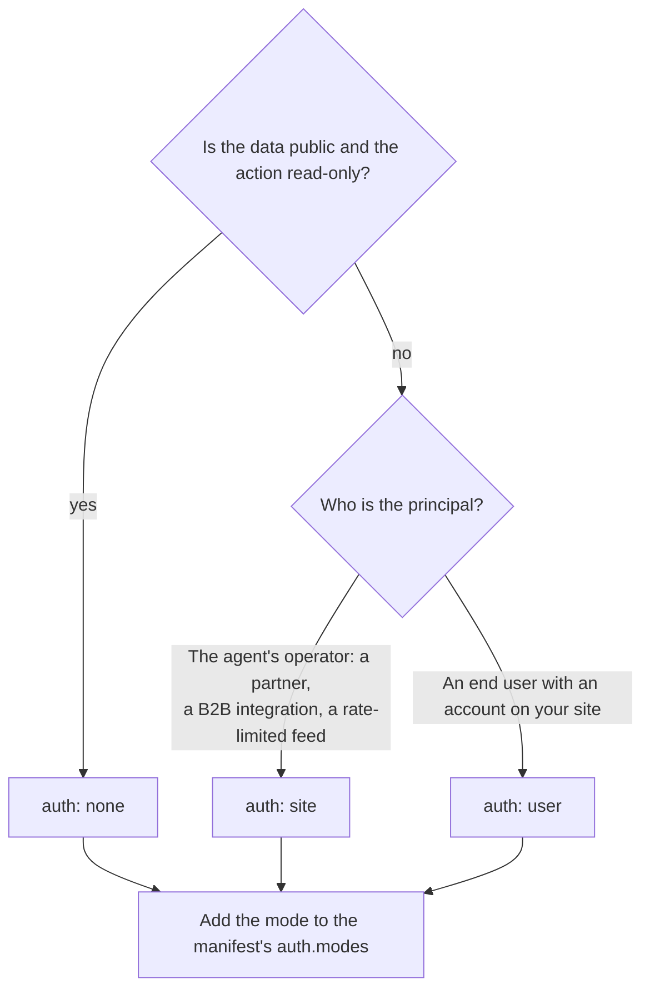

# Auth

An action's `auth` says who must be authenticated before it runs: nobody, the operator of the agent, or the end user the agent is acting for. The runtime establishes that identity from credentials and hands it to your handler as `context.onBehalfOf`. Your handler then authorizes with the same checks your UI applies. Nothing in AXE grants an agent more than your existing authorization allows.

## The three modes

| `auth` | Who authenticates | How                                                                                                                                                                                                                                                     |
| ------ | ----------------- | ------------------------------------------------------------------------------------------------------------------------------------------------------------------------------------------------------------------------------------------------------- |
| `none` | Nobody            | Public read-only actions: search classes, check stock, list units.                                                                                                                                                                                      |
| `site` | The agent         | `Authorization: Bearer <api-key>`, issued by you to the agent operator. Your `verifySiteKey` function says yes, no, or which actions the key may call.                                                                                                  |
| `user` | The end user      | The agent acts for one human. Either it passes through a token that human already granted it, which your `authenticate` function maps to `onBehalfOf`, or the runtime sends the human to `userLoginUrl` and binds the resume token to whoever signs in. |

The runtime enforces spec §16 at startup rather than at request time. `register` throws when an action's `auth` is not in the manifest's `auth.modes`. `createAXE` throws when `modes` includes `user` but neither `userLoginUrl` nor `authenticate` is set, or includes `site` without `verifySiteKey`.

## Choosing a mode



Most manifests list more than one mode: `none` for the search that starts every task, `user` for anything that touches an account. A wholesaler whose only callers are partner systems lists `site` alone. Do not choose `site` because it is simpler when the action changes a specific person's data: a partner's key identifies the partner, not the shopper, and your handler would have no `onBehalfOf` to authorize against.

## Passing your existing session into context

You have a login already. The runtime needs one function that turns a request into an identity, and there are two places to put it.

The first is `authenticate` on the `auth` config passed to `createAXE`. It receives the Web-standard request and returns an identity or `null`. It runs under every adapter, so it is the right place when the credential is self-describing: a bearer JWT, a session token you can look up.

The second is the adapter's `context` option on `axeExpress`, `axeNext`, and `axeFetch`. It receives the framework's own request object and returns an identity the same way. Use it when your framework has already resolved the session. If `context` returns an identity, including `null` for anonymous, `authenticate` is not consulted for that request; if it returns nothing, the runtime falls through to `authenticate`.

Either way the identity has one required member, `onBehalfOf`, an opaque stable user id. Handlers read it from `context.onBehalfOf`. What the agent sent in the request body's `context.onBehalfOf` is discarded before your handler runs; the runtime replaces it with what your function returned (spec P-INV-3 and P-AUTH-5). An agent cannot become another user by asserting a name.

Here is Northgate Admissions under Express, reading the same cookie session its web pages use:

<!-- include: examples/auth/express-session.ts#session -->
```ts
// Stand-in for your session store (express-session, iron-session, a sessions table).
const sessions = new Map<string, { applicantId: string; roles: string[] }>([
  ["s_7c1e9b", { applicantId: "applicant_4471", roles: ["applicant"] }],
]);

function sessionFromCookie(cookieHeader: string | undefined) {
  const match = /(?:^|;\s*)sid=([^;]+)/.exec(cookieHeader ?? "");
  return match?.[1] ? sessions.get(match[1]) : undefined;
}```
<!-- /include -->

<!-- include: examples/auth/express-session.ts#mount -->
```ts
const app = express();
app.use(express.json());
app.use(
  axeExpress(axe, {
    context: (req) => {
      const session = sessionFromCookie(req.headers.cookie);
      // `identity: null` means anonymous. A `user` action then returns a login_required
      // handoff instead of running.
      return {
        identity: session
          ? { onBehalfOf: session.applicantId, claims: { roles: session.roles } }
          : null,
      };
    },
  }),
);
app.listen(3000);```
<!-- /include -->

The handler sees only the established identity:

<!-- include: examples/auth/express-session.ts#action -->
```ts
axe.register(
  action("applications.status", {
    title: "Check application status",
    description:
      "Returns the current status of the signed-in applicant's admission application and the list of missing documents. Does not change anything.",
    readOnly: true,
    risk: "none",
    auth: "user",
    input: z.object({}),
    output: z.object({
      applicationId: z.string(),
      status: z.enum(["incomplete", "under-review", "decided"]),
      missingDocuments: z.array(z.string()),
    }),
    examples: [
      {
        input: {},
        output: { applicationId: "NU-2027-4471", status: "under-review", missingDocuments: [] },
      },
    ],
    // `context.onBehalfOf` is the identity the adapter established. Whatever the agent
    // put in the request body's context.onBehalfOf was discarded before this ran.
    handler: async ({ context }) => admissions.status(context.onBehalfOf!),
  }),
);```
<!-- /include -->

Here is Sunrise Yoga under Hono, verifying a bearer access token in `authenticate` instead:

<!-- include: examples/auth/fetch-jwt.ts#verify -->
```ts
// Stand-in for token verification. In production this is your JWT library (for example
// jose's jwtVerify with your issuer, audience, and signing keys) or an introspection call
// to your authorization server. It returns the claims when the token is valid and unexpired.
const issuedTokens = new Map<string, { sub: string; email: string; exp: number }>([
  ["at_2f8c1e", { sub: "member_1088", email: "dana@example.com", exp: 1_790_000_000 }],
]);

async function verifyAccessToken(token: string) {
  const claims = issuedTokens.get(token);
  if (!claims || claims.exp * 1000 < Date.now()) return null;
  return claims;
}```
<!-- /include -->

<!-- include: examples/auth/fetch-jwt.ts#create -->
```ts
const axe = createAXE({
  name: "Sunrise Yoga Studio",
  description:
    "Search upcoming yoga classes by date and style, see instructor names and spots left, and (once signed in) book or cancel a spot.",
  baseUrl: "https://sunriseyoga.example",
  humanFallbackUrl: "https://sunriseyoga.example",
  auth: {
    modes: ["none", "user"],
    userLoginUrl: "https://sunriseyoga.example/login",
    // Runs whenever an identity is needed: on the action call and again on continue,
    // resume, and poll. Return null for anonymous or invalid credentials.
    authenticate: async (request) => {
      const header = request.headers.get("authorization");
      const token = /^Bearer\s+(.+)$/i.exec(header ?? "")?.[1];
      if (!token) return null;
      const claims = await verifyAccessToken(token);
      if (!claims) return null;
      return { onBehalfOf: claims.sub, claims: { email: claims.email } };
    },
  },
  secret: process.env.AXE_SECRET,
});```
<!-- /include -->

Return `null` for an expired or malformed token, not an error. The runtime then treats the request as anonymous, and a `user` action produces a login handoff so the human can sign in again.

Both examples also set claims on the identity (roles in one, an email in the other). Handlers receive the whole identity as `identity`, so `claims` on `identity` carries roles or an email without a second lookup; `context.onBehalfOf` stays the one field that is also scoped into tokens and idempotency keys. Claims never go on the wire, never appear in events, and are not stored with tokens: a continuation or resume re-establishes the identity from the request.

Identity is established again on `/axe/continue`, `/axe/resume`, and poll. A token minted for one user and presented with another user's credentials, or anonymously, returns `not_found`, the same as an unknown token, so the response confirms nothing about the token's existence.

## user mode: pass-through

The simplest `user` mechanism is a credential the human already gave the agent. The agent sends `Authorization: Bearer <token>`; your `authenticate` function validates it and returns `onBehalfOf`; the action runs as that user.

How the agent obtained the token is out of the protocol's scope (spec P-AUTH-3). Today it is one of three things: an OAuth grant the user made to the agent through your existing authorization server, an API token the user copied from your account settings into the agent, or a signed-in browser session that a browser-based agent forwards with the request. Your `authenticate` function does not need to know which. It verifies the token the way your API already does and returns the user it belongs to.

Pass-through is also what makes the derived MCP server useful for signed-in work: an MCP client holding a token for your site can call `user` actions without a handoff.

## user mode: login handoff

When a `user` action is called and no identity can be established, the runtime does not return an error. It returns `needs_human` with `reason` set to `login_required`, `url` set to `userLoginUrl` with `axe_handoff=<id>` appended, a `resumeToken`, and text for the agent to relay (spec P-AUTH-4). The runtime keeps the original `input`, `context`, and `idempotencyKey` with the token record so the action can run later exactly as requested. The idempotency key is checked before the handoff is minted, so a malformed request fails immediately rather than after the human signs in.

Your login page receives the human with the handoff id in the query string. It authenticates exactly as it always has, then makes one call:

<!-- include: examples/auth/login-page.ts#login -->
```ts
// GET /login?axe_handoff=<id>: the normal form, carrying the handoff id through.
router.get("/login", (req, res) => {
  const handoffId = typeof req.query["axe_handoff"] === "string" ? req.query["axe_handoff"] : "";
  res.type("html").send(`
    <form method="post" action="/login">
      <input type="hidden" name="axe_handoff" value="${escapeAttr(handoffId)}">
      <label>Email <input name="email" type="email" required></label>
      <label>Password <input name="password" type="password" required></label>
      <button>Sign in</button>
    </form>`);
});

// POST /login: authenticate exactly as before, then record completion for the handoff.
router.post("/login", async (req, res) => {
  const body = req.body as Record<string, string | undefined>;
  const user = await signIn(body["email"] ?? "", body["password"] ?? "");
  if (!user) {
    res.status(401).send("That email and password did not match.");
    return;
  }
  res.cookie("sid", user.sessionId, { httpOnly: true, secure: true, sameSite: "lax" });

  const handoffId = body["axe_handoff"];
  if (handoffId) {
    // Binds the resume token to this applicant. The agent's next POST /axe/resume runs
    // the original action with context.onBehalfOf set to user.applicantId.
    const known = await axe.completeHandoff(handoffId, { onBehalfOf: user.applicantId });
    res.send(
      known
        ? "You're signed in. Return to your assistant to continue."
        : "You're signed in. The assistant's link had expired; ask it to try again.",
    );
    return;
  }
  res.redirect("/account");
});```
<!-- /include -->

`completeHandoff` records the authenticated identity on the handoff. When the agent presents the resume token to `/axe/resume`, the runtime runs the original action with `context.onBehalfOf` set to that identity, consumes the token, and returns the action's result. From the agent's point of view, the second response is what the first would have been had the user been signed in.

Until the login page calls `completeHandoff`, a resume returns `conflict` so the agent knows to wait:

```json
{
  "status": "error",
  "error": {
    "code": "conflict",
    "message": "Sign-in has not completed yet.",
    "retryable": true,
    "details": { "handoffStatus": "open" }
  }
}
````

The handoff id in the URL is the token record's id, not the signed resume token. Knowing it lets a page call `completeHandoff`, a server-side call you control, and nothing else. Resume tokens expire after 24 hours by default; `completeHandoff` returns `false` for an unknown or expired id, and the login page should tell the human to ask the agent to start again. [Human handoff](human-handoff.md#login-handoffs) covers the landing page and how the same mechanism serves handoffs your own handlers create.

## site mode: API keys

`site` mode is for callers whose principal is the agent operator: a retail partner's ordering system, an aggregator polling stock, an integration you have a contract with. The agent sends `Authorization: Bearer <api-key>` and your `verifySiteKey` function decides.

`verifySiteKey(key, request)` returns one of three things. `true` accepts the key for every `site` action. `false` rejects it; the agent receives `unauthorized`. An object with `actions` accepts the key for those action names only; a call to any other `site` action receives `forbidden` (spec P-AUTH-2). A call with no bearer header receives `unauthorized` before your function runs.

Kestrel Wholesale issues keys to retail partners and scopes each one:

<!-- include: examples/auth/site-keys.ts#keys -->
```ts
// Stand-in for your API-key table. Store a hash of each key, never the key itself.
// Your admin UI issues keys (shown once), records the hash, and sets revokedAt to revoke.
interface ApiKeyRecord {
  id: string;
  partner: string;
  actions: string[];
  revokedAt: string | null;
}

const keysBySha256 = new Map<string, ApiKeyRecord>([
  [
    "a5d9d9bd022ad27632f3fd4578df098262de607781ddb50c57c2dd521f5b7b1e",
    {
      id: "key_northlake_retail",
      partner: "Northlake Retail Co.",
      actions: ["stock.check", "purchase-orders.place"],
      revokedAt: null,
    },
  ],
  [
    "b8485c89ecc068bef48647d6d64940a19aa8e03091b8bb86d036319cfaa5813f",
    {
      id: "key_pricefeed",
      partner: "PriceFeed aggregator",
      actions: ["stock.check"],
      revokedAt: null,
    },
  ],
]);

const sha256 = (s: string) => createHash("sha256").update(s).digest("hex");

// The runtime does not pass the verdict's `id` to handlers in v0, so a handler that needs
// to know which partner is calling resolves it from the same bearer key.
function partnerFromRequest(request: Request): ApiKeyRecord {
  const key = request.headers.get("authorization")?.replace(/^Bearer\s+/i, "") ?? "";
  const record = keysBySha256.get(sha256(key));
  if (!record) throw new Error("verifySiteKey admitted a key that is no longer in the table");
  return record;
}```
<!-- /include -->

<!-- include: examples/auth/site-keys.ts#create -->
```ts
const axe = createAXE({
  name: "Kestrel Wholesale",
  description:
    "Check live stock levels and place purchase orders against a retail partner's wholesale account. Order history and returns are handled on the partner portal.",
  baseUrl: "https://wholesale.kestrel.example",
  humanFallbackUrl: "https://wholesale.kestrel.example/portal",
  auth: {
    modes: ["site"],
    verifySiteKey: async (key) => {
      const record = keysBySha256.get(sha256(key));
      if (!record || record.revokedAt) return false; // the agent receives `unauthorized`
      // Scoped keys: calling an action outside this list returns `forbidden`.
      return { id: record.id, actions: record.actions };
    },
  },
  policies: {
    // Declared here; enforced per key at your edge (docs/deploying.md#rate-limiting).
    rateLimit: { requestsPerMinute: 120, burst: 40 },
    termsUrl: "https://wholesale.kestrel.example/terms/agent-access",
  },
  contact: { email: "partners@kestrel.example" },
  secret: process.env.AXE_SECRET,
});```
<!-- /include -->

<!-- include: examples/auth/site-keys.ts#actions -->
```ts
axe.register(
  action("stock.check", {
    title: "Check stock",
    description:
      "Returns on-hand quantity, the next inbound date, and the partner's unit price for one catalog item. Does not reserve or order anything.",
    readOnly: true,
    risk: "none",
    auth: "site",
    input: z.object({ itemCode: z.string().describe("Catalog item code, for example KW-10442") }),
    output: z.object({
      itemCode: z.string(),
      onHand: z.number().int(),
      nextInbound: z.string().date().nullable(),
      unitPriceUsd: z.number(),
    }),
    examples: [
      {
        input: { itemCode: "KW-10442" },
        output: {
          itemCode: "KW-10442",
          onHand: 1200,
          nextInbound: "2026-10-14",
          unitPriceUsd: 4.35,
        },
      },
    ],
    handler: async ({ input }) => warehouse.stock(input.itemCode),
  }),
);

axe.register(
  action("purchase-orders.place", {
    title: "Place a purchase order",
    description:
      "Places a purchase order on the partner's account for one or more catalog items. Returns the order number and the expected ship date. Orders can be cancelled on the portal until they ship.",
    risk: "high",
    reversible: true,
    auth: "site",
    input: z.object({
      lines: z
        .array(z.object({ itemCode: z.string(), quantity: z.number().int().positive() }))
        .min(1)
        .describe("Items and quantities"),
      poReference: z
        .string()
        .optional()
        .describe("The partner's own PO number, printed on the invoice"),
    }),
    output: z.object({ orderNumber: z.string(), expectedShipDate: z.string().date() }),
    examples: [
      {
        input: { lines: [{ itemCode: "KW-10442", quantity: 200 }], poReference: "NR-2026-0917" },
        output: { orderNumber: "PO-88214", expectedShipDate: "2026-10-02" },
      },
    ],
    handler: async ({ input, request }) =>
      warehouse.placeOrder(partnerFromRequest(request).id, input.lines, input.poReference),
  }),
);```
<!-- /include -->

Issuing keys is your admin UI's job, not the SDK's: generate a long random key, show it once, store its hash, let the partner name and revoke it. When `verifySiteKey` returns an object, handlers receive it as `siteKey`, so `siteKey.id` identifies the partner without a second lookup, and the runtime scopes idempotency keys and tokens to that id when no user identity is present, so two partners reusing the same `idempotencyKey` never collide. The example still resolves the partner from the request to show that either approach works.

Two details about `site` mode and identity. First, after the key verifies, the runtime still calls `authenticate` or the adapter's `context`, so a `site` action can also carry an `onBehalfOf` when a partner forwards a user's credential. If your `authenticate` treats every bearer as a user token, make it return `null` for API keys. Second, `policies.rateLimit` is declared in the manifest but enforced by you, and `site` mode is where per-key limits belong: key the limiter at your edge on the bearer value and return 429 with `Retry-After`. See [Deploying](deploying.md#rate-limiting).

## Tenants and auth

On a multi-tenant platform, the `tenant` resolver returns a `TenantInfo` for each request, and its `auth` member can override the manifest's `modes` and `userLoginUrl` for that tenant. The override applies to the manifest served for that tenant and to the login handoff, which sends the human to the tenant's login page rather than the platform's.

`authenticate` and `verifySiteKey` are configured once for the platform. Your `authenticate` function can resolve the tenant from the request's host when sessions are per tenant; handlers receive `tenant` alongside `context` and should authorize `onBehalfOf` within it. Tokens and idempotency keys are already scoped by tenant, so a continuation minted on one tenant cannot be presented on another. [Platforms](platforms.md) covers the resolver and the index.

## The v1 OAuth path

v0 ships no authorization server: no client registration, no consent screen, no token issuance, no device flow. [ROADMAP.md](../ROADMAP.md) explains why. What v0 does ship is every seam an OAuth 2.1 server needs.

Your authorization server issues access tokens; `authenticate` validates them. For JWTs, verify the signature against your JWKS, the issuer, the audience (your `baseUrl` is a reasonable audience), and the expiry, then return the subject as `onBehalfOf`. For opaque tokens, call your introspection endpoint. The Sunrise Yoga example does this with a stand-in verifier; replacing the stand-in with a library call is the whole change.

`userLoginUrl` becomes your authorization endpoint. Point it at the URL that starts an authorization code flow for the agent's client, and carry the handoff id through in `state` or as an extra parameter you preserve. When the human consents and your redirect handler receives the code, call `completeHandoff(id, { onBehalfOf: subject })` alongside issuing the tokens. The agent's resume then runs the action as that user, and the agent holds an access token for pass-through on every later call.

For agents without a browser, such as voice assistants, the device authorization grant fits the handoff shape: the handoff `url` is your verification URI, the agent relays the user code, and completion is recorded when the user approves on any device.

Scopes are enforced in your handler. `authenticate` returns an identity, not an action allowlist, so a handler that requires a scope checks the token's claims (resolved from `request`) and returns `fail` with `forbidden` when it is missing.

The open question is how agents become clients. Dynamic client registration lets any agent register itself, which an open web of agents implies but which `policies.agents` allow lists exist to constrain. Pre-registration per vendor is safer and does not scale. The protocol takes no position in v0; the choice lives entirely in your authorization server, and nothing in the SDK changes either way.

## Next steps

- [Human handoff](human-handoff.md): the landing page, token lifecycle, and what to show the human.
- [Security](security.md): the threat model, including what identity and tokens do and do not protect against.
- [Platforms](platforms.md): per-tenant manifests and login URLs.
- [Deploying](deploying.md#rate-limiting): enforcing the rate limit you declare.
````
