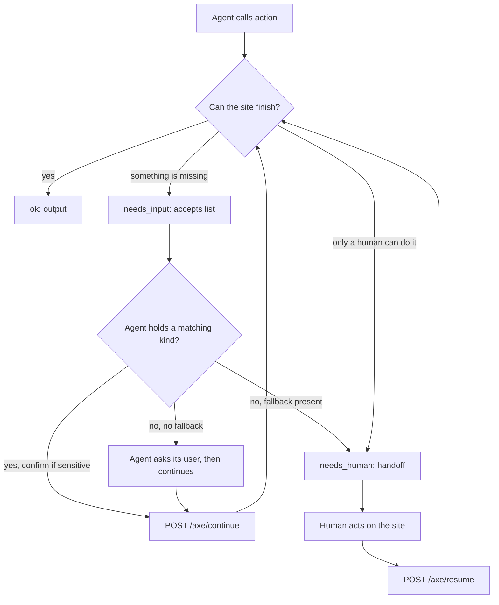
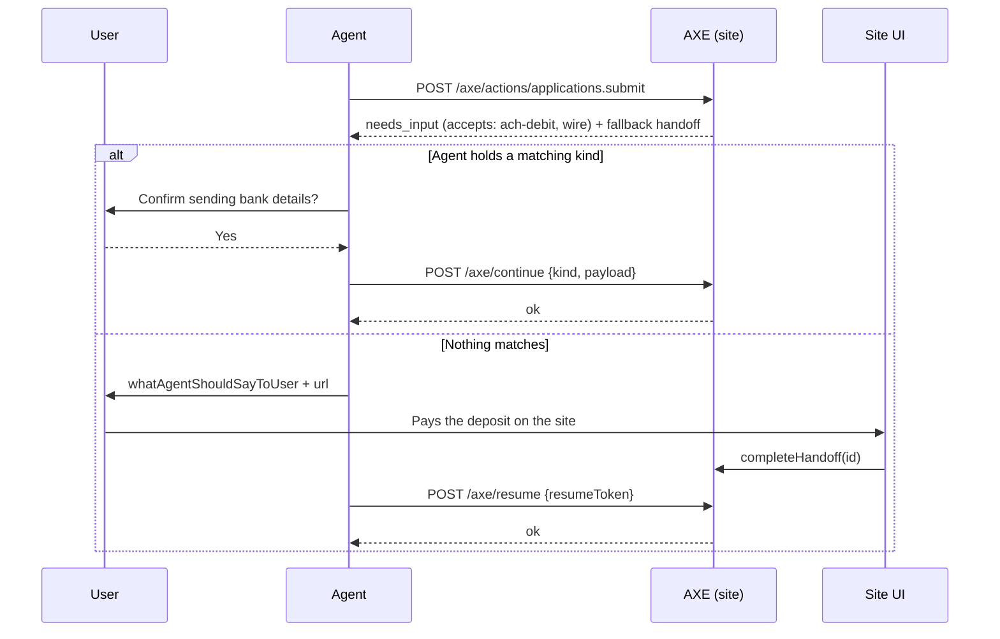

# Concepts

Everything in AXE is built from a dozen ideas. This page defines each one, shows the wire shape, and says when to use it. The normative text is the [protocol spec](../spec/AXE-PROTOCOL.md); this page is the map.

## Manifest

The manifest is the document an agent reads first: who you are, what you can do, how to authenticate, and what the rules are. It is served at `/.well-known/axe.json` (and `/axe/manifest`), cached for a few minutes, and contains every action definition.

```json
{
  "protocol": "axe/0.1",
  "name": "Northgate University Admissions",
  "description": "Check application status, upload transcripts and recommendation letters, and schedule campus visits for prospective students.",
  "baseUrl": "https://admissions.northgate.example",
  "humanFallbackUrl": "https://admissions.northgate.example",
  "auth": { "modes": ["none", "user"], "userLoginUrl": "https://admissions.northgate.example/login" },
  "actions": [],
  "policies": { "rateLimit": { "requestsPerMinute": 60 }, "termsUrl": "https://admissions.northgate.example/terms" },
  "contact": { "email": "agents@northgate.example" }
}
```

`description` is written for agents, not for a landing page: what this organization does and what an agent can accomplish here. `humanFallbackUrl` is where an agent sends the user when nothing else works. `policies` carries rate limits, terms, and an optional allow/deny list of agent vendors; `deny` wins.

In code you never write this JSON. `createAXE` takes the site-level fields and `describe` returns the manifest, with every registered action's schemas converted from Zod to JSON Schema.

## Action

An action is one thing an agent can do: a name, agent-facing text, an input schema, an output schema, safety metadata, and a handler. Names are namespaced kebab-case joined by dots: `applications.status`, `transcripts.upload`, `visits.schedule`.

<!-- include: examples/concepts/action.ts#action -->
```ts
axe.register(
  action("applications.status", {
    title: "Check application status",
    description:
      "Returns the current status of the signed-in applicant's admission application, the list of missing documents, and the decision date once released. Does not change anything.",
    readOnly: true,
    risk: "none",
    auth: "user",
    input: z.object({ term: z.enum(["fall-2027", "spring-2027"]).optional().describe("Admission term; defaults to the most recent application") }),
    output: z.object({
      applicationId: z.string(),
      status: z.enum(["incomplete", "under-review", "decided"]),
      missingDocuments: z.array(z.string()),
      decisionDate: z.string().nullable(),
    }),
    examples: [{ input: {}, output: { applicationId: "NU-2027-0142", status: "incomplete", missingDocuments: ["transcript"], decisionDate: null } }],
    handler: async ({ input, context }) => admissions.status(context.onBehalfOf!, input.term),
  }),
);```
<!-- /include -->

The metadata is what makes an action safe to expose:

| Field        | Meaning                                                                                     |
| ------------ | ------------------------------------------------------------------------------------------- |
| `readOnly`   | Changes nothing. Read-only actions never need an idempotency key.                           |
| `idempotent` | Repeating with the same `idempotencyKey` has no additional effect.                          |
| `reversible` | The effect can be undone by the user or the site.                                           |
| `risk`       | `none`, `low`, `medium`, or `high`. Agents confirm with the user before high-risk actions.  |
| `auth`       | `none`, `site`, or `user`. See [Auth modes](#auth-modes).                                   |

Registration validates everything it can: the name pattern, that a mutating action is not `risk: "none"`, that examples validate against the schemas, that display pointers resolve, that affordances bind real inputs, and that no agent-read text contains instructions aimed at the agent. A bad definition throws with a message that names the field to fix, before any agent sees it.

## Display and affordances: the agent's map of the site

Most agent tasks start with a read: "find me a 1-bedroom in Bellevue under $3,200", "which yin classes are on Tuesday", "what is the status of my application". The agent then has to show the user something and let them pick.

`display` is how an action says which fields matter. It points into the output with RFC 6901 JSON Pointers: where the list is, which field is the id the agent echoes back, the title, the price, the attributes to compare, the human page to link to, the disclaimer that must accompany any rendering. It is a sibling of `output`, never a replacement, and entirely optional.

`affordances` are the follow-ups that make sense for each item, with inputs pre-bound by pointer: from a search result, "Schedule a tour" and "Apply for this unit"; from an order, "Start a return". They are declared statically on the action, so an agent knows the graph before calling anything, and can be overridden per item at runtime under the reserved `_axe` key when the set depends on state. At most one is `primary`.

<!-- include: examples/apartments/site.ts#display -->
```ts
display: {
  kind: "list",
  items: "/units",
  item: {
    id: "/id",
    title: "/name",
    subtitle: "/address",
    image: "/photos",
    url: "/humanUrl",
    price: { amount: "/rentUsd", currency: "USD", period: "month" },
    attributes: [
      { label: "Bedrooms", path: "/bedrooms", format: "number" },
      { label: "Bathrooms", path: "/bathrooms", format: "number" },
      { label: "Size", path: "/sqft", format: "area", compare: "higher-better" },
      { label: "Available", path: "/availableFrom", format: "date", compare: "lower-better" },
      { label: "Pets", path: "/petPolicy", format: "text" },
      { label: "Parking", path: "/parking", format: "text" },
    ],
    badges: ["/badges"],
  },
  suggestedComparison: ["Size", "Available", "Pets"],
  emptyMessage: "No units match those filters. Widening the rent ceiling or removing the move-in date usually helps.",
  disclaimer: "Pricing and availability change frequently. Confirm on the listing page before applying.",
},```
<!-- /include -->

<!-- include: examples/apartments/site.ts#affordances -->
```ts
affordances: [
  { action: "tours.book", title: "Schedule a tour", input: { unitId: "/id" } },
  { action: "applications.submit", title: "Apply for this unit", input: { unitId: "/id" }, primary: true },
],```
<!-- /include -->

The reference renderers in `@axe/client/present` turn a result plus its `display` into a Markdown table or a self-contained HTML page whose buttons dispatch the bound affordance. [Presenting results](presenting-results.md) covers the whole arc.

## The result envelope

Every response from an action, a continuation, a resume, or a poll is one JSON object with a `status`. Agents branch on `status`, never on the HTTP status.

| `status`      | Members                                                                          | Meaning                                                          |
| ------------- | -------------------------------------------------------------------------------- | ---------------------------------------------------------------- |
| `ok`          | `output`                                                                         | Done.                                                            |
| `needs_input` | `reason`, `message`, `accepts`, `continuationToken`, `expiresAt`, `fallback`     | The agent may be able to supply what is missing.                 |
| `needs_human` | `handoff`                                                                        | The human must act on the site.                                  |
| `pending`     | `pollUrl`, `retryAfter`                                                          | Long-running work; poll later.                                   |
| `error`       | `error` with `code`, `message`, `retryable`, `details`                           | Failed.                                                          |

### Which to return when

| Situation                                                                                                     | Return        |
| ------------------------------------------------------------------------------------------------------------- | ------------- |
| The work is done.                                                                                             | `ok`          |
| Something is missing that an agent could plausibly hold: a payment credential, a document, an address, a consent. | `needs_input`, with a `fallback` handoff if a human could also do it on the site |
| Only a human can do the next step: sign in person, complete a CAPTCHA the site insists on, pass legal review, log in where no credential pass-through exists. | `needs_human` |
| The result will take longer than a request should wait.                                                       | `pending`     |
| Input was wrong, the caller is not allowed, the entity does not exist, state conflicts, the server failed.   | `error`       |

In a handler you return the output value for `ok`, or one of the helpers: `needsInput`, `handoff`, `pending`, `fail`. Thrown exceptions become a generic `internal` error and go to the `onError` hook; nothing internal reaches the agent.

Error codes are a fixed set: `invalid_input`, `unauthorized`, `forbidden`, `not_found`, `conflict`, `rate_limited`, `unavailable`, `internal`, `unsupported`. For `invalid_input`, `details` carries `issues`, each with a JSON Pointer `path` and a `message`, so agents fix their own mistakes without bothering the user.

## The escalation ladder

The most important idea in the protocol. When an action cannot complete, the site's first move is to ask the agent for a specific thing; the human is the last resort.



Three rungs:

1. **Complete.** Return `ok`.
2. **Ask the agent.** Return `needs_input` with an ordered `accepts` list. Each entry names a `kind` (`payment.ach-debit`, `identity.government-id`, `document.url`, `consent.terms`, ...), a JSON Schema for the payload, and whether it is `sensitive`. An agent with a wallet or credential store fulfills it without involving the user beyond a confirmation.
3. **Hand off to the human.** Return `needs_human`, or attach a `fallback` handoff to a `needs_input` so an agent that can satisfy nothing goes straight to the human without another round trip.

The property manager example shows all three: submitting an application needs a deposit that can only be paid by ACH or wire (rung two, with two `accepts` and a `fallback`), and signing the lease requires an in-person signature (rung three).

<!-- include: examples/apartments/site.ts#submit-handler -->
```ts
handler: async ({ input, context, needsInput, handoff }) => {
  const app = await db.createApplication(input.unitId, context.onBehalfOf!);
  return needsInput({
    reason: "payment_required",
    message: `A refundable $${app.depositUsd} holding deposit is required to submit. Cards are not accepted.`,
    accepts: [
      accept(kinds.payment.achDebit, { description: "Authorize a one-time ACH debit for the deposit." }),
      accept(kinds.payment.wireConfirmation, {
        description: "Provide the wire reference number after sending to the instructions below.",
        instructions: app.wireInstructions,
      }),
    ],
    state: { applicationId: app.id },
    // Only reached if the agent can satisfy neither option above.
    fallback: handoff({
      reason: "payment_required",
      instructions: "Pay the holding deposit by ACH or wire on the application page.",
      url: `https://oakridge-rentals.example/applications/${app.id}/deposit`,
      whatAgentShouldSayToUser:
        "Oakridge only takes the deposit by bank transfer, and I don't have bank details I can use for you. Can you complete it on their site? I'll finish the application once it's paid.",
      state: { applicationId: app.id },
    }),
  });
},
onContinue: async ({ kind, payload, state }) => {
  const { applicationId } = state as { applicationId: string };
  await payments.settleDeposit(applicationId, kind, payload);
  return db.submit(applicationId);
},
onResume: async ({ state }) => db.submit((state as { applicationId: string }).applicationId),```
<!-- /include -->

## Requirements and kinds

A requirement is one `accepts` entry: a `kind`, a `title`, an agent-facing `description`, a `schema`, `sensitive`, and optional `instructions` the agent relays (wire details, where to obtain a document). Kinds are namespaced: the well-known registry in [`spec/KINDS.md`](../spec/KINDS.md) covers payment, identity, documents, contact, and consent; sites add their own under `x-<org>.<name>`.

Well-known kinds are what let an agent wallet fulfill a requirement automatically. `@axe/core/kinds` ships each one as a typed definition, and `accept` builds an entry from it, so a site writes `accept(kinds.payment.achDebit, { description })` instead of hand-rolling a schema. The server validates the submitted `payload` against the chosen entry's schema on `/axe/continue`; a failed validation returns `invalid_input` and does not consume the token. [Requirements and kinds](requirements-and-kinds.md) goes deep.

## Handoff and resume

A handoff is a structured request that the human do one thing on the site: a `reason`, `instructions` (what the human does), a `url` that lands on the step, a `resumeToken`, an `expiresAt`, and `whatAgentShouldSayToUser` (how the agent frames it). The SDK appends `axe_handoff=<id>` to the URL; the page at that URL can call `completeHandoff` when the human finishes, and `onResume` receives the original `state` plus whatever the page recorded.



Both tokens are signed, opaque to the agent, bound to the originating action, input, and user, single-use, and expire (continuation tokens in about 15 minutes, resume tokens in about 24 hours). The `state` you attach never crosses the wire; it is stored server-side and delivered back to `onContinue` or `onResume`. [Human handoff](human-handoff.md) covers the landing page and failure modes.

## Idempotency

Every mutating action requires an `idempotencyKey` in the request envelope. Replaying a key with the same input, action, and user within 24 hours returns the original result without running the handler; replaying it with different input returns `conflict`. `@axe/client` generates a UUID per attempt automatically. The default store is in-memory; `IdempotencyStore` is a two-method interface you implement with Redis or a table for multi-instance deployments.

## Auth modes

| Mode   | Who authenticates | How                                                                                                                    |
| ------ | ----------------- | ---------------------------------------------------------------------------------------------------------------------- |
| `none` | Nobody            | Public read-only actions.                                                                                              |
| `site` | The agent         | `Authorization: Bearer <api-key>`; your `verifySiteKey` function says yes, no, or which actions the key may call.       |
| `user` | The end user      | Pass-through of a token the human already granted the agent (your `authenticate` function maps it to `onBehalfOf`), or a `login_required` handoff to your login page that binds the resume token to whoever signs in. |

The agent's claimed `onBehalfOf` in the request body is never trusted; handlers see the identity your code established. No OAuth server is built into v0; [Auth](auth.md) shows where one plugs in.

## Flows

A flow is a named, documented path through the affordance graph: `rent-a-unit` is `units.search` → `applications.submit` → `leases.sign`. Flows carry no server-side state and impose no order. They exist so agents and human readers of the manifest see the intended narrative, and so a site can group its actions. Affordances remain the primary chaining mechanism because they are local, stateless, and self-describing.

## Risk levels

| `risk`   | Use when                                                                                             |
| -------- | ---------------------------------------------------------------------------------------------------- |
| `none`   | The action is read-only.                                                                             |
| `low`    | The effect is small and trivially reversed: save a search, join a waitlist, add a note.              |
| `medium` | The effect commits the user to something reversible at low cost: a booking with free cancellation.  |
| `high`   | Money moves, a legal commitment is made, identity is asserted, or the effect is hard to reverse.     |

Agents use `risk` to decide how much to confirm with the user. Declaring it truthfully is part of the [honesty rules](audit.md#honesty-rules).

## Events

Every handled request emits one event: action, status, where on the ladder it landed, agent vendor, latency, tenant. No payloads, no identities. Sinks for console, JSON lines, and OpenTelemetry ship in `@axe/core/events`. [Analytics](analytics.md) has the day-one queries.

## Next steps

- [Designing actions](designing-actions.md): turning a human flow into actions, and writing descriptions a model can act on.
- [Presenting results](presenting-results.md): the search → present → select arc in full.
- [Protocol spec](../spec/AXE-PROTOCOL.md): every rule, numbered.
