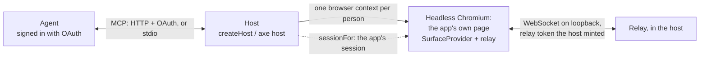

# Unattended mode: the agent uses the app for you

The person signs in once in the agent's own UI. The SDK then runs the application in a private browser for that person, and the agent acts through the application's real controls, availability, reasons, and handlers. There is no pairing code or ordinary application tab to keep open. If the application itself still requires login, the host can briefly present that private session's standard sign-in controls as a secure semantic form; after sign-in it returns to unattended operation. This is the provider's default desktop/mobile adapter; browser-native WebMCP is an additional direct path where supported, and an attended relay remains a diagnostic fallback.



`@summationai/axe-host` is the host. For each principal and tenant an agent authenticates as, it starts an isolated Playwright browser context on the agent's first tool call, applies an application session when `sessionFor` returns one, injects the relay connection before any page script runs, opens the application, and waits until the page's surface is connected. Every tool call then routes to that person's private tab. The rules are [S-HOST-1] to [S-HOST-10] in [spec/SURFACE.md](../spec/SURFACE.md) §9.2.

## What the application needs

Initialize the application with `axe surface init`. The default adds the relay browser client and makes the generated provider connect only when a host injects a scoped connection (`window.__AXE_RELAY__`). Pass `--browser-only` only when this application will never support a desktop/mobile provider session:

<!-- include: examples/host/page.ts#page -->
```ts
const handle = autoSurface({ root: document.body });
// In the host's hidden browser, `window.__AXE_RELAY__` is set before this script runs, and
// injectedRelay() returns it (unattended: no indicator, approvals through the agent). In a
// person's own browser it returns null, and nothing connects.
const options = injectedRelay();
if (options) connectRelay(handle.surface, options);
```
<!-- /include -->

It is also always on inside a hosted session, whatever the application's own flag says there: the generated gate is `enabled = <your flag or the development gate> || injectedRelay() !== null`. `injectedRelay()` reads the global when called and is null on the server, so a server render is unaffected.

<!-- include: examples/host/page.ts#gate -->
```ts
// A feature flag that is off for the person must still let a hosted session turn the surface on.
export const surfaceOn = (flag: boolean): boolean => flag || injectedRelay() !== null;
```
<!-- /include -->

An integration written by hand needs the same two things: connect when `injectedRelay()` returns a connection, and do not let a flag that is off for the person keep the provider from mounting in a hosted session. `--start <path>` opens the page the agent starts on (for example `/dashboards`). The attended alternative, where the person's own tab connects to a relay (`axe surface init --relay-dev`, or `--relay <url>`), keeps the injected connection first:

<!-- include: examples/host/page.ts#fallback -->
```ts
// The attended fallback: the person's own tab connects to your relay when no host injected one.
export const relayConnection = (dev: boolean) =>
  injectedRelay() ??
  (dev
    ? {
        url: "wss://relay.yogastudio.example/tab",
        getToken: () =>
          fetch("/api/relay-token", { method: "POST" }).then(
            async (r) => ((await r.json()) as { token: string }).token,
          ),
      }
    : null);
```
<!-- /include -->

## Local development

The host needs a Chromium that Playwright can start. The repository's Playwright browsers work; otherwise install one with `npx playwright install chromium` (or pass `browser.executablePath`).

1. Start your application as usual, for example on `http://localhost:5173`.
2. Sign in once, in a visible browser the host opens for you:

   ```sh
   npx @summationai/axe host login http://localhost:5173
   ```

   Sign in as you normally would, then press Enter in the terminal (or close the window). The signed-in session (cookies and `localStorage`, a Playwright storage state) is saved to `.axe/host-state.json`, readable only by you. It is your session: keep it out of version control (add `.axe/` to `.gitignore`) and log in again when it expires. `--state <file>` saves it elsewhere.

3. Connect the agent. Let Claude Code start the host itself:

   ```sh
   claude mcp add summation -- npx @summationai/axe host --dev --stdio --app http://localhost:5173
   ```

   Or start it in a terminal, which prints the exact commands and configuration for your machine, with absolute paths to Node, the CLI, and the saved session:

   ```sh
   npx @summationai/axe host --dev --app http://localhost:5173 --name summation
   ```

   ```text
   axe host: serving MCP on http://127.0.0.1:4718/mcp for http://localhost:5173 (development, loopback only)
   Signed in with the session saved in /Users/you/app/.axe/host-state.json.

   Connect Claude Code to this host (HTTP):
     claude mcp add --transport http summation http://127.0.0.1:4718/mcp --header "Authorization: Bearer axh_…"
   Or let Claude Code start the host itself (stop this one first):
     claude mcp add summation -- /usr/local/bin/node /Users/you/app/node_modules/axe/dist/index.js host --dev --stdio --app http://localhost:5173 --state /Users/you/app/.axe/host-state.json

   Claude Desktop (claude_desktop_config.json), which starts the host itself:
     {
       "mcpServers": {
         "summation": {
           "command": "/usr/local/bin/node",
           "args": ["/Users/you/app/node_modules/axe/dist/index.js", "host", "--dev", "--stdio", "--app", "http://localhost:5173", "--state", "/Users/you/app/.axe/host-state.json"]
         }
       }
     }

   Watch the hidden session: http://127.0.0.1:4718/watch/5f0c…
   ```

   Claude Desktop starts its servers with its own working directory, so use the printed configuration with absolute paths rather than `npx`.

4. Ask the agent to do something in the app ("open the Q3 dashboard and add a filter for EMEA"). Its first tool call starts the hidden session; `relay_tabs` shows it, `surface_read` returns what the page shows, `surface_observe` lists the page's controls, `surface_wait` waits for slow work, and `host_screenshot` shows the page. A consequential act asks you in Claude first. Open the watch URL to follow along; Stop there closes the session.

`--start <path>` opens a page other than the app's root, `--port` changes the HTTP port (default 4718), and `--headed` shows the browser window for debugging.

`axe host login` is a development shortcut: one person's session, captured once, reused for the one development identity (`dev`). Production authentication is OAuth in the agent plus your application's `sessionFor`, below. The command line runs development only.

The same in code:

<!-- include: examples/host/dev.ts#dev -->
```ts
// Loopback only, one identity ("dev"), the session `axe host login` saved, and a key for /mcp.
const host = createHost({
  appUrl: "http://localhost:5173",
  startPath: "/dashboards",
  dev: true,
  sessionFor: storageStateSession(".axe/host-state.json"),
});
const address = await host.listen({ port: 4718 });
console.log(`MCP: ${address.mcpUrl} (Bearer ${host.devAgentKey}); watch: ${address.watchUrl}`);
```
<!-- /include -->

What development mode allows: the host listens on loopback only (`0.0.0.0` is refused) and refuses any request whose peer or `Host` header is not loopback, so a web page cannot reach it through DNS rebinding. `/mcp` needs the printed key, or stdio. The watch page lives behind a random path.

## What the agent sees

| Tool                                                                        | What it does                                                                                              |
| --------------------------------------------------------------------------- | --------------------------------------------------------------------------------------------------------- |
| `relay_tabs`                                                                | The hosted tab of the person the agent signed in as (started on the first call).                         |
| `surface_observe`                                                           | The page's controls under one revision: what can be done now, why not the rest, values.                  |
| `surface_set-field`, `surface_run-control`, `surface_load-more`             | Act through the page's own setters, handlers, and lists.                                                  |
| `surface_ledger`                                                            | Every act and refusal in the tab, with who asked.                                                         |
| `surface_read`                                                              | What the page shows the person (headings, text, fields, tables), redacted and bounded: status, results, reports. |
| `surface_wait`                                                              | Wait until something shows on the page (a status, a finished report), at most two minutes.                 |
| `relay_stop`                                                                | End the session (the agent's next call may start a new one).                                              |
| `host_screenshot`                                                           | A PNG of the page as it is now (MCP image content), to show the person a result.                          |

There is no `relay_pair`: the tab is the agent's by identity. Navigation is through the UI too: links, and the derived `page:navigate` entry for same-origin paths.

A consequential control (high risk, or one the derived surface holds for approval) is asked of the person in the agent's own UI, through MCP elicitation, within the same tool call ([Relay](relay.md), "Approvals"). Nobody sees the hidden page, so nothing is ever approved there; a client that cannot ask the person gets `approval_required` and the act does not run.

## Production

A production host authenticates agents with OAuth access tokens (the SDK is a resource server; your authorization server issues the tokens) and gets each person's application session from your `sessionFor`.

<!-- include: examples/host/production.ts#production -->
```ts
const host = createHost({
  appUrl: "https://app.yogastudio.example",
  startPath: "/schedule",
  sessionFor,
  // Agents: an OAuth 2.1 resource server. `identify` names the person and tenant a verified
  // token speaks for; each gets its own browser context, started on their first tool call.
  agentAuth: {
    verifier,
    requiredScopes: ["app:act"],
    resource: "https://agents.yogastudio.example/mcp",
    identify: (authInfo) => {
      const sub = authInfo.extra?.["sub"];
      const org = authInfo.extra?.["org"];
      return typeof sub === "string" && typeof org === "string"
        ? { principal: sub, tenant: org }
        : null;
    },
  },
  // Where MCP clients find your authorization server (RFC 9728).
  protectedResource: {
    resource: "https://agents.yogastudio.example/mcp",
    authorizationServers: ["https://auth.yogastudio.example"],
    scopesSupported: ["app:act"],
  },
  // The identity provider's pages, if a session ever needs them; every other origin is refused.
  allowedOrigins: ["https://auth.yogastudio.example"],
  maxSessions: 50,
  idleMs: 10 * 60_000,
  onEvent: (event) => console.info("[host]", JSON.stringify(event)),
});

// Behind a TLS terminator at https://agents.yogastudio.example. The relay the hosted pages
// connect to runs inside this process, on loopback.
await host.listen({ host: "0.0.0.0", port: 8080 });
```
<!-- /include -->

Connect Claude Code with `claude mcp add --transport http summation https://agents.yogastudio.example/mcp`: it reads the protected-resource metadata, finds your authorization server, and signs the person in, in its own UI.

### sessionFor: the application issues the session

The SDK does not issue application sessions and never sees a password. `sessionFor` receives the verified identity (`principal`, `tenant`, and `authInfo`, the verified access token) and returns what the browser context starts with: `cookies`, `headers` (sent to the application's origin only), a `storageState`, or `localStorage` entries. Return null to refuse.

If this is a valid identity that still needs to sign in to the application, throw `SessionLoginRequired` with a trusted, short-lived application URL:

```ts
import { SessionLoginRequired, type SessionFor } from "@summationai/axe-host";

const sessionFor: SessionFor = async ({ principal, tenant }) => {
  const exchange = await appSessions.exchange({ principal, tenant });
  if (exchange.status === "login_required") {
    throw new SessionLoginRequired({
      url: exchange.loginUrl,
      instructions: "Sign in on the application's page, then return to your assistant.",
      whatAgentShouldSayToUser: "Please connect your application account so I can continue.",
      expiresAt: exchange.expiresAt,
    });
  }
  if (exchange.status === "refused") return null;
  return { cookies: exchange.cookies };
};
```

The host returns a native `needs_human` result, never asks the model for credentials, and keeps the original tool request in memory. After the person signs in, `axe_resume` calls `sessionFor` again and replays that request. The resume token is bound to the verified principal and tenant, expires with the login URL, and returns the stored result on duplicate resumes. The login page must bind its opaque request to the same identity and make it single-use; do not put a username, password, or application session in the URL.

<!-- include: examples/host/production.ts#session-for -->
```ts
// The application, not the SDK, issues the session: here a short-lived one minted for the user
// the agent's access token names, set as the app's own session cookie. Return null to refuse.
const sessionFor: SessionFor = async ({ principal, tenant, authInfo }) => {
  if (!authInfo?.scopes.includes("app:act")) return null;
  const session = await mintAgentSession({
    userId: principal,
    orgId: tenant,
    scopes: authInfo.scopes,
  });
  return {
    cookies: [
      {
        name: "app_session_jwt",
        value: session.jwt,
        url: "https://app.yogastudio.example",
        expires: Math.floor(session.expiresAt / 1000),
        httpOnly: true,
        secure: true,
        sameSite: "Lax",
      },
    ],
  };
};
```
<!-- /include -->

Two ways an application implements it:

- **A session from your identity provider.** Your backend asks the provider for a short-lived session for the verified user (most providers can mint or exchange one server-side for a user they know, for example after an OAuth token exchange), and `sessionFor` sets it as the session cookie your app already reads.
- **An agent session you issue.** Your backend signs a short-lived "agent session" for the user and tenant, and your session middleware accepts it like its own, marked as the agent's so your audit log and permissions can tell. This keeps the provider out of the loop and lets you narrow what an agent session may do.

Either way, bind it to the identity the verified token names, keep it short-lived (the host starts a new context, and asks again, after `idleMs`), and scope it to what the agent is allowed to do. `cookieSession(fn)` is a shorthand for a `sessionFor` that returns cookies.

### Generic sign-in fallback: the same hosted browser

An application does not need a session broker to participate. When its live Surface profile reports `authentication.state: "signed-out"`, the host pauses the agent's request and returns an `application_login_required` handoff. The linked page is served by `@summationai/axe-host` and presents the ordinary, visible HTML fields and actions from the exact Playwright page and browser context the agent will use as a clean provider-branded form. It does not imitate the application page or show a screenshot. Each step is bound to the exact current document and form revision; one submit applies all values and the chosen action to that private page, and a page change makes an old step unusable. Polls never overlap, a submission stays visibly in progress while the application advances, and a temporary connection failure preserves the current fields and retries instead of claiming the link expired. This handles standard first-party sign-in forms and common multi-step forms without a remote-control toolbar.

The MCP client presents the handoff through its native URL mode when available, producing a Sign in action instead of exposing the capability URL as chat text. The agent presents it once. While its page is actively polling, another application call receives `application_login_pending` without another URL; if the page was closed and has stopped polling, the same URL can be presented again. Framework-only DOM remounts preserve the person's entered value and do not become a new visible step; the page waits for changed authentication semantics to settle before replacing the form. Password visibility is a local eye control inside the field, never a primary action, and toggling it preserves the value. If the application renders or enables its submit button only after processing the field's input event, the host re-reads the same semantic form after filling and uses that newly available primary action; otherwise it submits the exact bound form. All detection is based on standard HTML and accessibility semantics, with no connector-specific selectors or labels.

As soon as a fresh Surface observation reports `signed-in`, the form is replaced by a visually distinct green completion screen. It deliberately remains on screen instead of attempting `window.close()`, which embedded agent browsers handle inconsistently; the person can close it explicitly and return to the assistant. Progress text distinguishes initial submission, waiting for the named application, and an unusually slow sign-in. If the person returns to the agent immediately after submitting, `axe_resume` waits briefly for the application's Surface to report `signed-in` instead of returning a premature loading conflict. It then replays the original request once but keeps the page's status endpoint alive long enough to show completion. A genuinely expired or ended session instead gets an amber terminal page with instructions to start again.

This entire fallback is provider infrastructure. The consuming application adds no login endpoint, callback, iframe, session broker, Playwright dependency, or MCP code. Its only contract is an accurate live profile:

```ts
profile: () => ({
  id: "example-app",
  name: "Example App",
  authentication: { state: auth.loading ? "unknown" : auth.user ? "signed-in" : "signed-out" },
});
```

The handoff URL is an expiring capability bound in memory to the verified principal, tenant, hosted tab, and original request. The page accepts a bounded semantic form submission only from its own origin. Field values are sent directly to the bound browser page and are never returned by MCP, Surface, screenshots, ledgers, or events; the handoff never exposes cookies, storage, or relay tokens. Production requires HTTPS. The generic form deliberately does not collect credentials after a redirect to a different identity-provider origin: Google, Microsoft, enterprise SSO, passkeys, and similar federated methods need a provider OAuth connector or `sessionFor`, so credentials stay on the identity provider's own page.

`sessionFor` is still preferable when the provider and application can exchange identity silently: it avoids showing a browser and starts already signed in. The session-bound view is the generic fallback that preserves a zero-backend application installation.

### Deployment

- The host runs one Chromium and one browser context per active person, in one process, with its relay inside on loopback. Each context holds a full page of your application: measure one, size `maxSessions` from it, and route each person to one host process.
- Install a browser where the host runs (`npx playwright install chromium --with-deps` in the image), or pass `browser.executablePath`, or `browser.launch` for a remote browser. `playwright-core` is a dependency of `@summationai/axe-host` only; the application's pages never load it.
- With a relay you run yourself, pass it as `relay` with `relayUrl` and `relaySecret`, and forward its events to `relayEvent` so Stop there closes the hosted session. `extraTools` (in `@summationai/axe-mcp`) and `handleAgent` with `relayAgentContext` (in `@summationai/axe-relay/server`) are the pieces the host builds its MCP server from.

## Security model

A server-side browser acting as a person is powerful, so the host states what it guarantees ([S-HOST-1] to [S-HOST-10]) and [Security](security.md) lists the threats:

- **Identity binding.** A session is for exactly the principal and tenant the agent's verified token names. The host mints the page's relay token for that identity only, and the relay serves an agent only its own person's tab ([S-RELAY-3]). A tenant change is another session.
- **Isolation.** One browser context per identity: no cookie, storage, cache, or permission is shared between two people. They share only the browser process.
- **No pairing, safely.** Pairing exists to prove that the person at the tab is the person the agent speaks for. Here the host opens the tab itself, for the identity the agent signed in as, so there is nothing to prove. The connection is injected only into frames of the application's origin, and the renewal function mints only for those frames.
- **Credentials stay out of the agent.** What `sessionFor` returns is never logged, put in an event, or returned by a tool; headers go only to the application's origin; relay tokens live ten minutes (`tokenTtlSeconds`) and renew in-band. An ordinary `sessionFor` error is not passed on to the agent. `SessionLoginRequired` exposes only the application-supplied login URL and safe instructions. In the generic fallback, one same-origin, revision-bound form submission writes directly to the bound browser page and is never put in MCP content, Surface observations, screenshots, or ledgers.
- **Everything through the UI.** The agent changes nothing except through the page's own controls; the host adds no write tool. `host_screenshot` only reads.
- **Approvals through the agent.** Consequential acts wait for the person in the agent's UI.
- **Navigation stays on the application** (the request-forgery defense). A navigation to any origin other than the application's and `allowedOrigins` is refused and the page stays where it was; `restrict: "all"` refuses every other request too. Cloud metadata addresses are never reachable, and service workers, which could fetch around these rules, are blocked. Each refusal is an event naming the origin.
- **Bounded.** `maxSessions` and `idleMs` bound the browsers a host runs; Stop by the person or the owner holds an identity until it is resumed; revoking the agent's OAuth grant ends its access.

Threats that remain yours: the blast radius of an agent session (narrow what your agent session may do, and audit it; every act is in the tab's ledger under `<principal> (agent via relay)`, and `onEvent` records sessions and refusals); subresource requests to other origins, which `restrict: "navigations"` allows (use `restrict: "all"` for an application that loads nothing from elsewhere, and an egress policy for the host); and page text, which reaches the agent as data and must never be treated as instructions.

## Limits

- Everything is in memory in one process: sessions, the relay's tabs, and Stop holds reset on restart.
- The secure human form handles standard first-party HTML forms, including multi-step username, password, and one-time-code flows. Federated identity-provider redirects, file selection, passkeys, hardware keys, camera/microphone challenges, and CAPTCHAs require a provider OAuth connector, a brokered application session, or another application-supported authentication method.
- Watching is screenshots, polled once a second, in development; there is no live stream.
- An act whose click navigates the page (a link, a form that posts and reloads) is answered `ok` with `navigated: true` just before the page unloads, and the agent is told to observe the new page. An act whose page goes away without a navigation it could see (a crash, a closed page), or does not answer in time, is `unavailable` with `details.reason: "outcome_unknown"` and `retryable: false`: it was sent and may have taken effect, so it is neither retried nor reported as nothing applied ([S-RELAY-14]).
- The development storage state is one person's cookies. It expires like any session, and anyone who can read the file can use it.

## Next steps

- [Relay](relay.md): the relay the host connects its pages to, approvals in the agent's UI, and the attended fallback.
- [Easy mode](auto-surface.md): what the surface derives from the page, and how to refine it.
- [MCP](mcp.md): sessions, OAuth, and elicitation.
- [Security](security.md): the threat model.
